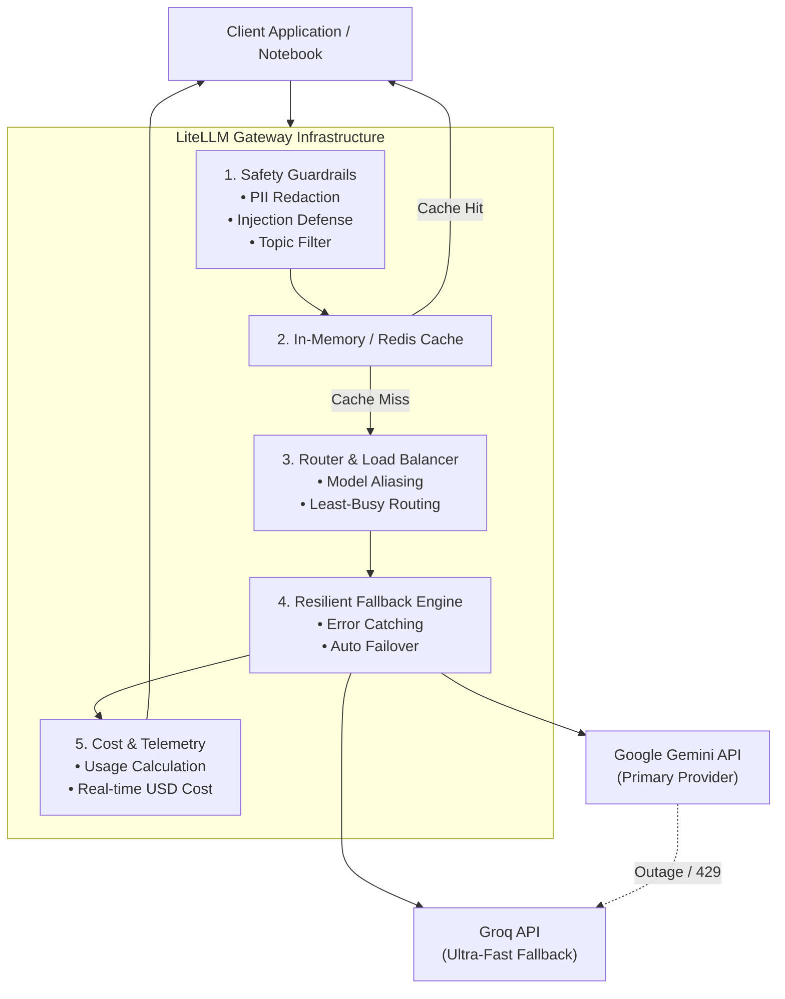

# LiteLLM Gateway: Gemini + Groq

A production-grade reference implementation and interactive tour of **LLM Gateway Patterns** using [LiteLLM](https://docs.litellm.ai/), **Google Gemini**, and **Groq**.

This repository demonstrates how to build an abstraction layer between client applications and multiple AI providers. It solves real-world production challenges such as **vendor lock-in, provider outages, rate limits (HTTP 429), cost tracking, latency reduction via caching, dynamic load balancing, LangChain integration, and pre-request safety guardrails**.

---

## Table of Contents

- [Why an LLM Gateway?](#why-an-llm-gateway)
- [Gateway Architecture](#gateway-architecture)
- [Quick Start](#quick-start)
  - [1. Prerequisites](#1-prerequisites)
  - [2. Environment Setup](#2-environment-setup)
  - [3. Configure API Keys](#3-configure-api-keys)
  - [4. Running the Notebook](#4-running-the-notebook)
- [Complete Walkthrough of Gateway Patterns](#complete-walkthrough-of-gateway-patterns)
  - [1. Provider Configuration & Robust Initialization](#1-provider-configuration--robust-initialization)
  - [2. Unified Multi-Provider Completions](#2-unified-multi-provider-completions)
  - [3. Cross-Provider Comparison in a Single Loop](#3-cross-provider-comparison-in-a-single-loop)
  - [4. Automated Failover & Fallback Chains](#4-automated-failover--fallback-chains)
  - [5. Token Usage & Real-Time Cost Tracking](#5-token-usage--real-time-cost-tracking)
  - [6. High-Performance Response Caching](#6-high-performance-response-caching)
  - [7. Router & Virtual Provider Aliases](#7-router--virtual-provider-aliases)
  - [8. Load Balancing Across Heterogeneous Providers](#8-load-balancing-across-heterogeneous-providers)
  - [9. LangChain LCEL Integration & Fallbacks](#9-langchain-lcel-integration--fallbacks)
  - [10. Intelligent Task-Aware Routing (`smart_chat`)](#10-intelligent-task-aware-routing-smart_chat)
  - [11. Pre-Request Guardrails: PII Redaction](#11-pre-request-guardrails-pii-redaction)
  - [12. Pre-Request Guardrails: Prompt Injection Defense](#12-pre-request-guardrails-prompt-injection-defense)
  - [13. Pre-Request Guardrails: Topic & Policy Checks](#13-pre-request-guardrails-topic--policy-checks)
- [Troubleshooting & Production Notes](#troubleshooting--production-notes)
  - [Handling Gemini Free-Tier Quota Limits (HTTP 429)](#handling-gemini-free-tier-quota-limits-http-429)
  - [Why `litellm.drop_params = True` is Essential](#why-litellmdrop_params--true-is-essential)
  - [Dynamic Environment Reloading in Notebooks](#dynamic-environment-reloading-in-notebooks)
- [Project File Structure](#project-file-structure)

---

## Why an LLM Gateway?

When scaling LLM-powered applications, making raw SDK calls to a single AI provider creates severe single points of failure:

| Problem | Gateway Solution |
| :--- | :--- |
| **Provider Downtime (HTTP 500 / 503)** | Automatic failover to healthy secondary providers in milliseconds. |
| **Rate Limits (HTTP 429)** | Transparent retries, fallbacks, and traffic load-balancing. |
| **Vendor Lock-in** | Single OpenAI-standard interface across 100+ model providers. |
| **Unpredictable API Costs** | Token-level real-time USD cost calculation and budgeting. |
| **High Latency & Repeated Prompts** | Response caching yielding 10x–15x speedups at $0 extra cost. |
| **Data Privacy & Security Risks** | Local PII sanitization and prompt injection screening before prompts leave your network. |

---

## Gateway Architecture



---

## Quick Start

### 1. Prerequisites

- **Python 3.10+** (tested up to Python 3.15)
- Active API keys:
  - [Google AI Studio API Key](https://aistudio.google.com/app/apikey)
  - [Groq Cloud API Key](https://console.groq.com/keys)

### 2. Environment Setup

Create and activate a virtual environment:

```bash
# macOS / Linux
python3 -m venv .venv
source .venv/bin/activate

# Windows (PowerShell)
python -m venv .venv
.venv\Scripts\Activate.ps1
```

Install the required gateway dependencies:

```bash
python -m pip install -r requirements.txt
```

> **Note on `litellm[proxy]`:** The proxy extra is included because LiteLLM's internal caching paths import optional serialization and proxy utilities during cache hits.

### 3. Configure API Keys

Copy the sample environment file to `.env`:

```bash
cp .env.example .env
```

Edit `.env` with your actual keys:

```dotenv
GEMINI_API_KEY=your_actual_gemini_api_key_here
GEMINI_MODEL=gemini/gemini-flash-lite-latest
GROQ_API_KEY=your_actual_groq_api_key_here
GROQ_MODEL=groq/openai/gpt-oss-120b
```

> [!IMPORTANT]
> Never commit `.env` to source control. It is already included in `.gitignore`.

### 4. Running the Notebook

Launch Jupyter or open the workspace in VS Code / Cursor:

```bash
jupyter lab llm_gateway.ipynb
# or
code llm_gateway.ipynb
```

Make sure the notebook kernel points to your `.venv` environment.

---

## Complete Walkthrough of Gateway Patterns

The core implementation lives in [`llm_gateway.ipynb`](file:///Users/sagarvashnav/Desktop/%20%20ny%20/lite_llm_gateway/llm_gateway.ipynb). Below is the comprehensive explanation of each section:

### 1. Provider Configuration & Robust Initialization

To avoid runtime crashes and handle provider differences gracefully, LiteLLM is initialized with strict logging, typing helpers, and parameter filtering:

```python
import logging
import litellm

# Silence verbose LiteLLM internal debugging
logging.getLogger("LiteLLM").setLevel(logging.WARNING)
litellm.suppress_debug_info = True

# Drop unsupported params (e.g., temperature) automatically for newer frontier models
litellm.drop_params = True
```

The gateway defines strict response-narrowing wrappers:
- `require_model_response()`: Rejects unhandled streaming/async objects where a concrete `ModelResponse` is expected.
- `response_text()`: Safely extracts text, failing explicitly if the model returned an empty choice.
- `response_model_name()`: Confirms the exact model that generated the completion.
- `response_usage()`: Validates token accounting (`Usage`).

---

### 2. Unified Multi-Provider Completions

Different LLM providers traditionally demand distinct client SDKs, header formats, and payload structures. LiteLLM standardizes this into an OpenAI-compatible call signature:

```python
# Gemini Call
response_gemini = complete_sync(
    model="gemini/gemini-flash-lite-latest",
    messages=[{"role": "user", "content": "Explain RAG in one sentence."}],
)

# Groq Call (same syntax!)
response_groq = complete_sync(
    model="groq/openai/gpt-oss-120b",
    messages=[{"role": "user", "content": "Explain RAG in one sentence."}],
)
```

**Key Benefit:** You swap or add providers by modifying the model string without changing a single line of business logic.

---

### 3. Cross-Provider Comparison in a Single Loop

Because the interface is uniform, you can benchmark or evaluate responses across heterogeneous models in one concise iteration:

```python
prompt = "Explain RAG in one sentence."
providers = [
    ("Gemini", GEMINI_MODEL),
    ("Groq", GROQ_MODEL),
]

for provider, model in providers:
    try:
        response = complete_sync(model=model, messages=[{"role": "user", "content": prompt}])
        print(f"{provider:<8}: {response_text(response)}")
    except ProviderAPIError as error:
        print(f"{provider}: unavailable ({type(error).__name__}); continuing.")
```

---

### 4. Automated Failover & Fallback Chains

Production systems cannot afford downtime when a provider suffers an outage (HTTP 500/503) or rate limit (HTTP 429). The gateway implements an asynchronous fallback sequence:

```python
async def complete_with_fallbacks(
    models: list[str], messages: list[dict[str, Any]], **kwargs: Any
) -> ModelResponse:
    last_error: Exception | None = None
    for index, model in enumerate(models):
        try:
            result = await litellm.acompletion(
                model=model, messages=messages, stream=False, **kwargs
            )
            return require_model_response(result)
        except ProviderAPIError as error:
            last_error = error
            if index < len(models) - 1:
                print(f"{model} unavailable ({type(error).__name__}); trying {models[index + 1]}.")

    raise last_error
```

- When `GEMINI_MODEL` fails, the gateway catches the exception, logs a warning, and immediately attempts `GROQ_MODEL`.
- The notebook includes an outage simulation function (`simulated_completion`) proving that outages are intercepted gracefully without raising user-facing errors.

---

### 5. Token Usage & Real-Time Cost Tracking

LiteLLM maintains an active pricing dictionary covering all major commercial and open-source endpoints:

```python
from litellm import completion_cost

response = complete_sync(
    model=GEMINI_MODEL,
    messages=[{"role": "user", "content": "Write a haiku about AI."}]
)

cost = completion_cost(completion_response=response)
usage = response_usage(response)

print(f"Input tokens:  {usage.prompt_tokens}")
print(f"Output tokens: {usage.completion_tokens}")
print(f"Cost:         ${cost:.8f}")
```

**Why this matters:** Enables chargeback, client billing, per-request budgeting, and alerts on expensive model invocations before bills arrive.

---

### 6. High-Performance Response Caching

Repeated identical questions (e.g. FAQ lookup, classification, common user inputs) should not re-query external LLM APIs. LiteLLM provides a transparent cache layer:

```python
from litellm.caching.caching import Cache

litellm.cache = Cache()  # In-memory cache (supports Redis/S3 for production)

# First Call (Cache Miss):
# Calls the provider API -> Latency ~1.8 seconds, incurs token cost.
first = complete_sync(model=GEMINI_MODEL, messages=[{"role": "user", "content": prompt}], caching=True)

# Second Call (Cache Hit):
# Returns instantly from memory -> Latency ~0.13 seconds (14x faster), $0 cost!
cached = complete_sync(model=GEMINI_MODEL, messages=[{"role": "user", "content": prompt}], caching=True)
```

---

### 7. Router & Virtual Provider Aliases

Hardcoding model strings (like `gemini/gemini-flash-lite-latest`) inside application services couples code to specific vendors. LiteLLM's `Router` decouples them using virtual model aliases:

```python
from litellm.router import Router

router = Router(model_list=[
    {"model_name": "gemini", "litellm_params": {"model": GEMINI_MODEL, "api_key": GEMINI_API_KEY}},
    {"model_name": "groq",   "litellm_params": {"model": GROQ_MODEL,   "api_key": GROQ_API_KEY}},
])

# Application code calls generic aliases:
resp_1 = router.completion(model="gemini", messages=[{"role": "user", "content": "Summarize AI."}])
resp_2 = router.completion(model="groq",   messages=[{"role": "user", "content": "Reverse string in Python."}])
```

---

### 8. Load Balancing Across Heterogeneous Providers

The gateway can distribute high-throughput traffic across multiple providers under a single shared endpoint using strategies such as `least-busy` or `round-robin`:

```python
router = Router(
    model_list=[
        {
            "model_name": "chat",
            "litellm_params": {"model": GEMINI_MODEL, "api_key": GEMINI_API_KEY},
            "model_info": {"id": "gemini"},
        },
        {
            "model_name": "chat",
            "litellm_params": {"model": GROQ_MODEL, "api_key": GROQ_API_KEY},
            "model_info": {"id": "groq"},
        },
    ],
    routing_strategy="least-busy",
)

# Requests to "chat" are intelligently balanced between Gemini and Groq
for request_number in range(4):
    response = router.completion(model="chat", messages=[{"role": "user", "content": "Hi"}])
```

---

### 9. LangChain LCEL Integration & Fallbacks

LiteLLM integrates natively with LangChain via `ChatLiteLLM`. You can combine LangChain Expression Language (LCEL) pipelines with cross-provider fallbacks:

```python
from langchain_litellm import ChatLiteLLM
from langchain_core.prompts import ChatPromptTemplate
from langchain_core.output_parsers import StrOutputParser

primary = ChatLiteLLM(model=GEMINI_MODEL, temperature=0.2)
fallback = ChatLiteLLM(model=GROQ_MODEL, temperature=0.2)

# Robust LLM that automatically swaps to Groq if Gemini fails
robust_llm = primary.with_fallbacks([fallback])

prompt = ChatPromptTemplate.from_messages([
    ("system", "You are an AI assistant. Reply in JSON: {{\"answer\": ...}}"),
    ("user", "{question}"),
])

chain = prompt | robust_llm | StrOutputParser()
result = chain.invoke({"question": "Benefits of an LLM gateway?"})
```

---

### 10. Intelligent Task-Aware Routing (`smart_chat`)

Not all requests require an expensive frontier model. The gateway can classify incoming queries with a sub-second, ultra-cheap model (Groq) and route them accordingly:

- **Code Generation** $\rightarrow$ Primary: Gemini, Fallback: Groq
- **Summarization** $\rightarrow$ Primary: Groq (ultra-fast throughput), Fallback: Gemini
- **General Queries** $\rightarrow$ Primary: Gemini, Fallback: Groq

```python
def smart_chat(user_query: str) -> dict:
    task = classify_task(user_query)  # Fast classification via Groq
    
    routing = {
        "code": [GEMINI_MODEL, GROQ_MODEL],
        "summary": [GROQ_MODEL, GEMINI_MODEL],
        "general": [GEMINI_MODEL, GROQ_MODEL],
    }
    
    chain = routing.get(task, routing["general"])
    response = call_with_fallbacks(chain, [{"role": "user", "content": user_query}])
    cost = completion_cost(completion_response=response)
    
    return {
        "detected_task": task,
        "model_used": response_model_name(response),
        "answer": response_text(response),
        "cost_usd": f"${cost:.6f}",
    }
```

---

### 11. Pre-Request Guardrails: PII Redaction

Before sending prompts to external cloud models, the gateway inspects and redacts Personally Identifiable Information (PII) including:
- Email addresses
- Phone numbers (India and US formats)
- US Social Security Numbers (SSN)
- Indian Aadhaar and PAN cards

```python
user_input = "My phone is +91 9876543210 and PAN is ABCDE1234F."
redacted_text, redactions = redact_pii(user_input)
# Result: "My phone is [REDACTED_PHONE_IN] and PAN is [REDACTED_PAN]."
```

---

### 12. Pre-Request Guardrails: Prompt Injection Defense

The gateway detects and rejects known adversarial jailbreak attempts (e.g., *"ignore previous instructions"*, *"DAN mode"*, *"disregard rules"*) locally before making an API call:

```python
def check_prompt_injection(messages):
    for pattern in INJECTION_PATTERNS:
        if re.search(pattern, content, re.IGNORECASE):
            raise GuardrailViolation("Blocked: prompt injection pattern detected")
```

---

### 13. Pre-Request Guardrails: Topic & Policy Checks

Enforces local corporate policy by intercepting forbidden topics (e.g., weapons, exploits, illegal substances) before dispatching requests to upstream LLMs:

```python
FORBIDDEN_TOPICS = ["weapon", "bomb", "hack", "exploit", "malware", "drugs", "self-harm"]
# Raises GuardrailViolation immediately if a forbidden topic keyword is found
```

---

## Troubleshooting & Production Notes

### Handling Gemini Free-Tier Quota Limits (HTTP 429)

If you encounter:
```text
RateLimitError: Quota exceeded for metric: generativelanguage.googleapis.com/generate_content_free_tier_requests, limit: 20, model: gemini-2.5-flash
```

- **Cause:** Google AI Studio imposes a strict cap of **20 requests per day per project** for preview models (like `gemini-2.5-flash` or `gemini-3.8-flash`) on the Free Tier (`GenerateRequestsPerDayPerProjectPerModel-FreeTier`).
- **Solution:** 
  1. Set `GEMINI_MODEL=gemini/gemini-flash-lite-latest` or `gemini/gemini-3.5-flash-lite` in `.env`. These lightweight models have their own independent quota pools and significantly higher daily limits.
  2. In production, link a billing account in Google Cloud / AI Studio to transition from Free Tier to Pay-As-You-Go limits.

### Why `litellm.drop_params = True` is Essential

Newer Gemini models (Gemini 3+) and certain open-source endpoints reject or deprecate standard parameters such as `temperature` or `top_p`. Without `litellm.drop_params = True`, invoking LangChain's `ChatLiteLLM(temperature=...)` will fail with `UnsupportedParamsError`. Setting this flag in initialization ensures that incompatible parameters are cleanly dropped without crashing the request.

### Dynamic Environment Reloading in Notebooks

In Jupyter, `load_dotenv()` with default settings does not overwrite environment variables that are already loaded in memory. The notebook initializes with:

```python
load_dotenv(Path.cwd() / ".env", override=True)
```

This guarantees that any changes made to `.env` (such as switching `GEMINI_MODEL`) immediately take effect whenever you rerun the setup cell.

---

## Project File Structure

```text
lite_llm_gateway/
├── README.md               # Complete architecture guide and pattern documentation (this file)
├── requirements.txt        # Python package dependencies (litellm[proxy], langchain, etc.)
├── .env.example            # Template for required environment variables
├── .env                    # Local secrets and provider configurations (git-ignored)
├── .gitignore              # Ignores .venv, .env, __pycache__, and checkpoints
└── llm_gateway.ipynb       # Interactive Jupyter notebook implementing all 13 gateway patterns
```
